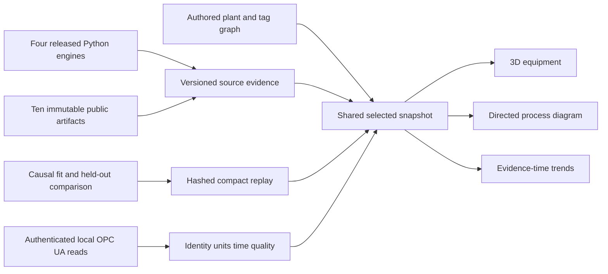

# Architecture

1. [Plant and state](architecture/01_plant-and-state.md): stable equipment identity and bounded physical interpretation.
2. [Determinism and evidence time](architecture/02_determinism-and-trace.md): causal channel support and hashed replay.
3. [Validation](architecture/03_the-gate.md): separate algebra, source, contract and interaction evidence.
4. [Runtime lanes](architecture/04_live-lane.md): paused replay, local process calculation and read-only site observations.
5. [Offline pipeline](architecture/05_precompute-pipeline.md): real source execution, training and measured comparison.
6. [Model evaluation](architecture/06_model-evaluation.md): identical held-out cases, refusals and paired uncertainty.
7. [Delivery](architecture/07_deploy.md): static public client and separate site setup.
8. [Contracts](architecture/08_data-contracts.md): identity, unit, graph revision and source quality.

